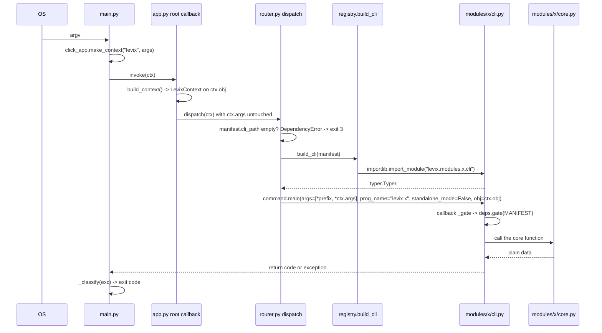

# Command architecture

The complete path from `levix <token>` to a Python function, and the two shapes a
command can have: platform commands, registered directly on the root Typer, and module
commands, reached by forwarding.

## The path



## Command inventory

| Command | Kind | Registered in | Reaches |
|---------|------|---------------|---------|
| `levix` (no arguments) | eager | `app.py:84` — `if ctx.invoked_subcommand is None: dashboard_command(ctx)` | `LevixDashboard.run()` |
| `--version`, `-V` | eager option | `app.py:75-81`, `is_eager=True`, raises `typer.Exit(0)` | prints `levix 0.4.0` |
| `dashboard` | platform | `app.py:87` | `commands/dashboard_cmd.py` |
| `doctor` | platform | `app.py:88-90` | `commands/doctor_cmd.py` |
| `update` | platform | `app.py:91` | `commands/update_cmd.py` |
| `create-module` | platform | `app.py:92-94` | `commands/create_module_cmd.py` |
| `config …` | platform group | `app.py:95` `add_typer` | `commands/config_cmd.py` |
| `plugins …` | platform group | `app.py:96` `add_typer` | `commands/plugins_cmd.py` |
| `monitor`, `hacker`, `files`, `tube`, `game`, `music`, `ai` | module, forwarded | `router.register_modules` | `registry.build_cli` → `modules/*/cli.py` |
| `q`, `cmd` | module alias, forwarded | `router._attach(name=alias, subcommand=command.name)` from `ai`'s `CommandInfo.aliases` | the same `build_cli` call as `ai`, with `ask`/`command` prefixed onto the argv |

Platform commands are imported inside `build_app()`, not at module scope, so the root
module never pulls the command package in on import (`app.py:48-56`).

Platform subcommands, complete:

| Group | Commands |
|-------|----------|
| `config` | `show`, `list [SECTION]`, `get KEY`, `set KEY VALUE [--yes]`, `unset KEY`, `reset [--yes]`, `path [config\|file\|data\|cache\|state\|log\|database]`, `edit` |
| `plugins` | `list [--origin all\|official\|third-party]`, `info NAME` |

Module subcommands, complete and read from the seven manifests:

| Module | Commands (aliases) |
|--------|--------------------|
| `ai` | `ask` (`q`), `explain`, `command` (`cmd`), `models`, `check`, `key` (`key set` / `key clear`) |
| `files` | `browse`, `search`, `preview`, `copy`, `move`, `rename`, `delete` |
| `game` | `snake`, `tetris`, `scores` |
| `hacker` | `matrix`, `info`, `network` |
| `monitor` | `overview`, `cpu`, `memory`, `disk`, `network`, `processes`, `live` |
| `music` | `play`, `info`, `devices`, `library`, `playlist` |
| `tube` | `info`, `download`, `play` |

## Why forwarding, not a click subclass

The obvious way to make `levix --help` cheap is to override `click.Group.get_command`
and import the real command only when it is selected. `router.py:1-14` records why that
is unavailable:

> Typer 0.27 runs on its own vendored click fork (`typer._click`), whose `TyperGroup`
> does not derive from `click.Group`, so overriding those methods would target a class
> hierarchy that does not exist at runtime.

Verified at runtime: `type(command).__mro__` for the built root is
`typer.core.TyperGroup → typer._click.core.Group → …`; `click.Group` is not in it.

Lazy loading is therefore achieved by registering a *real but thin* command for each
module whose body only forwards:

```python
app.command(
    command_name,
    help=help_text or manifest.summary,
    add_help_option=False,
    context_settings={
        "ignore_unknown_options": True,
        "allow_extra_args": True,
    },
)(dispatch)
```

| Setting | Consequence |
|---------|-------------|
| `add_help_option=False` | `-h`/`--help` after a module name is not consumed by the root; it reaches the module's own Typer, so `levix tube -h` is Typer's real help, not a copied summary |
| `ignore_unknown_options` | every module option (`--formats`, `--playlist`, `--root`) is accepted by the root without the root knowing it exists |
| `allow_extra_args` | the module's argv lands in `ctx.args` verbatim |
| `help=help_text or manifest.summary` | the root's command list is built entirely from manifest data — a module line shows the summary, an alias line shows that command's own `CommandInfo.help` |

Consequence of the trade: the root cannot validate module options. A misspelled module
option is reported by the module's own Typer, which is the correct owner of that
vocabulary.

## How a manifest alias reaches its command

`CommandInfo.aliases` produce one additional top-level command per alias, and that
command *is* the command it names — not a second spelling of the module group.
`router._attach` records the canonical subcommand (`router.py:54-61`) and
`router._forward` prefixes it onto the argv it hands to the sub-app
(`args=[*prefix, *ctx.args]`, `router.py:100`):

| Invocation | The sub-app receives | Result |
|------------|----------------------|--------|
| `levix ai ask "hi"` | `["ask", "hi"]` | the `ask` command (`prefix` empty for the module's own name) |
| `levix q "hi"` | `["ask", "hi"]` | the same command, because `q` is `ask`'s alias |
| `levix q -h` | `["ask", "-h"]` | `ask`'s own help page, headed `Usage: levix ai ask [OPTIONS] [prompt]` |
| `levix hi alias --times 3` | `["greet", "alias", "--times", "3"]` | the example plugin's `greet`, three lines |

Before the prefix existed, `levix q "hi"` forwarded `["hi"]`, click reported
`No such command 'hi'`, and `main._classify` answered with the list of modules — exit 4
for a command the root had just advertised. The alias and the group disagreed about what
`levix q -h` meant, which is the failure the prefix closes.

Verified by `tests/test_router.py:172-202` (`levix nt via-alias`, the alias's own help
page, and the root listing) and `tests/test_plugin_example.py::test_a_plugin_alias_is_registered_the_same_way`.

Inside the module, `ai/cli.py:100-101` registers the same aliases on its own Typer as
hidden commands, so `levix ai q "hi"` works too and the module's help page does not show
the duplicate.

## Registration inside a module

Every module builds its Typer app from its own manifest, so `levix <module> -h` and the
dashboard's description cannot drift apart:

```python
surface = {"info": info, "download": download, "play": play}
for command in MANIFEST.commands:
    application.command(command.name, help=command.help)(surface[command.name])
```

`tube/cli.py:54-70`, `ai/cli.py:71-102`. Typer's `command()` has no alias parameter, so
AI registers a shorthand twice (`application.command(alias, help=info.help, hidden=True)`).

| Typer setting | Value | Why |
|---------------|-------|-----|
| `name` | module name | matches `prog_name=f"levix {manifest.name}"` |
| `help` | `MANIFEST.summary` | one source for the sentence |
| `no_args_is_help` | `True` | a bare `levix tube` prints help rather than failing |
| `callback` | `_gate` | dependency check before any subcommand body |
| `context_settings` | `{"help_option_names": ["-h", "--help"], "max_content_width": 100}` | same as the root |

## Argument-to-function contract

| Layer | Parses | Decides | Renders |
|-------|--------|---------|---------|
| root click context | global options and the module token | — | — |
| `router._forward` | nothing; it passes `ctx.args` | whether the module is loadable | — |
| module Typer | arguments, options, defaults, `typer.BadParameter` | which function, with which values | all console output |
| module `core.py` | nothing | all real rules | returns plain data |

Two consequences that are visible in the code rather than asserted:

* `CommandInfo` deliberately does not model parameters (`module.py:57-68`): "Typer's type
  hints are the single source of truth for arguments. Duplicating them here creates a
  second contract that drifts from the first."
* Options that mean the same thing on several commands are shared `typer.Option` objects,
  as in `ai/cli.py:41-48`, so one help string covers five commands.

## Reading configuration from a command

Four shapes appear, all of them reading the forwarded `LevixContext`:

| Shape | Used by | Code |
|-------|---------|------|
| `_configured(ctx, dotted, fallback)` | tube, hacker | `tube/cli.py:347`, `hacker/cli.py:283` — read `obj.value(dotted)`, fall back when there is no `obj` at all or when the read raises `ConfigError`/`TypeError`/`ValueError` |
| `_obj` / `_ctx` / `_context` with a `build_context()` fallback | music, arcade, ai, dashboard, plugins, config | `music/cli.py:85`, `arcade/cli.py:69`, `ai/cli.py:110` |
| direct `obj.value(...)` with an `is not None` guard | monitor | `systempulse/cli.py:283,288` — `if obj is not None else 15` / `else 1.0` |
| `self._value(dotted, fallback)` | dashboard | `dashboard/app.py:243-246` |

The fallbacks exist for tests that build a module's Typer directly. Because the router
passes `obj=ctx.obj`, the fallback branch is not taken in normal use —
`tests/test_router.py:139-149` proves it by making the stub write the received object's
type into a file.

## Exit codes returned by commands

A module command returns an int and the router propagates it:

```python
result = command.main(args=[*prefix, *ctx.args], prog_name=…, standalone_mode=False, obj=ctx.obj)
return int(result) if isinstance(result, int) else 0
```

`standalone_mode=False` is what makes this work — it stops click from calling
`sys.exit()` itself, so the exit code travels back to `main()` and `main()` remains the
only place that maps an exception to a code. See `ERROR_HANDLING.md` for the table and
`_classify` order.

## Known gaps

* **Module help shows completion options.** The root sets `add_completion=False`, but a
  module's `typer.Typer(...)` does not, so `levix ai -h` prints `--install-completion`
  and `--show-completion`. Verified again on 2026-11-05 on 0.27.3. They are inert inside a
  forwarded app — the completion the option installs refers to the child invocation — so
  the honest fix is `add_completion=False` on every module app.
* **A bad module subcommand is reported as exit 4 with module suggestions.** Verified:
  `levix monitor platform` prints `unknown command: platform` then
  `available: ai, files, game, hacker, monitor, music, tube` and exits 4, because
  `main._classify` matches click's `No such command` text without knowing it was raised
  inside a sub-app. `monitor`'s own command list is never shown.
* **`prog_name` is right but the help header is not fully canonical.** `main()` builds
  the context with `prog_name="levix"` while the root callback's `ctx.info_name` differs
  for aliases, so a forwarded error inside `levix q …` reports `levix ai …`. That is the
  intended behaviour (`router.py:90-93`), just worth knowing when reading a bug report.
* **`UnknownModuleError` (exit 4) is defined but never raised.** The only producers of
  exit 4 in the tree are `main._classify` pattern-matching click's message, plus
  `plugins info` raising `typer.Exit(code=4)` directly (`plugins_cmd.py:70-72`). The class
  exists for the contract, not for current use.

### Closed since the first draft of this page

* **Top-level aliases no longer mislead.** `q` and `cmd` used to be a second *module*
  name: `levix q "hi"` reached the module group, click reported `No such command 'hi'`,
  and only `levix q ask "hi"` worked. `router._attach` now carries the canonical
  subcommand and `_forward` prefixes it, so `levix q "hi"` is `levix ai ask "hi"` and
  `levix q -h` is `ask`'s own help page. See "How a manifest alias reaches its command".
* **The three module comments that contradicted the forwarding code are corrected.**
  `arcade/cli.py:69-79`, `music/cli.py:80-89` and `ai/cli.py:110-119` claimed
  `ctx.obj` is None for a forwarded module command. It is not: `router._forward` passes
  `obj=ctx.obj`, and the `build_context()` branches are now documented as the
  direct-app-invocation fallback they actually are.
