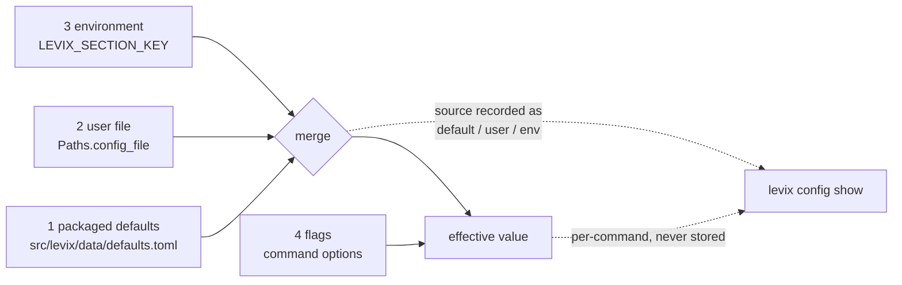

# Configuration architecture

Four layers, one validated read path, comment-preserving writes, and a hand-maintained
schema. Everything in this document is read from `src/levix/config.py`,
`src/levix/data/defaults.toml`, `src/levix/paths.py` and `src/levix/commands/config_cmd.py`,
and each worked example below was executed.

## Why four layers and not pydantic

`config.py:7-9` gives the reason the schema is a table of dataclasses rather than a model
class: pydantic pulls compiled `pydantic-core`, which costs startup and complicates
standalone builds, in order to validate about thirty keys. `Spec` is therefore a frozen
dataclass of `kind`, `minimum`, `maximum`, `choices` with one `coerce()` method, and
`SCHEMA` is a plain nested dict. Adding a key means editing `SCHEMA` *and*
`defaults.toml`; a missing default raises `ConfigError("packaged defaults are missing
<section>.<key>")` at load time, which is what keeps the two in step.

## Layers

| Layer | Written by | Read at | Scope | Persisted |
|-------|-----------|---------|-------|-----------|
| 1 packaged defaults | the distribution; `DEFAULTS_FILE = Path(__file__).parent / "data" / "defaults.toml"` | every `Config.load` | machine-wide | yes, inside the wheel (force-included in the build target) |
| 2 user file | `levix config set/unset/reset/edit`, or whatever `$EDITOR`/`$VISUAL` opens | `if paths.config_file.exists()` | per user, per platform directory | yes, `config.toml` |
| 3 environment | the shell, a CI job, `tests/conftest.py` | `_env_overrides()` at load | per process | no |
| 4 flags | the command line | inside a command function, never merged into `Config` | one invocation | no |

Layer 4 is deliberately outside the engine. `Config` never sees a flag: tube reads
`--output` first and `tube.output_dir` second inside
`core.resolve_output_dir(flag_value, configured)`, which also returns *which* layer chose
it so the command can say `writing to D:\Media (from --output)`. The same pattern appears
as `requested = format_spec or _configured(typer_ctx, "tube.default_format", "best")`.

## Environment variables

The rule is `LEVIX_<SECTION>_<KEY>`; the code strips the prefix, lower-cases the rest and
splits once on `_`, so the section is the first token and the key may contain underscores.

| Variable | Resolves to | Verified value |
|----------|-------------|----------------|
| `LEVIX_AI_MODEL=llama3.1` | `ai.model` | yes |
| `LEVIX_AI_BASE_URL=http://127.0.0.1:8080/v1` | `ai.base_url` | yes — the key keeps its underscore |
| `LEVIX_TUBE_OUTPUT_DIR=D:/Media` | `tube.output_dir` | yes |
| `LEVIX_GENERAL_THEME=hacker` | `general.theme` | yes, and reported as `source=env` |
| `LEVIX_MONITOR_INTERVAL_SECONDS=2.5` | `monitor.interval_seconds` | yes, coerced to `float` |
| `LEVIX_LOGGING_LEVEL=debug` | `logging.level` | yes |
| `LEVIX_GENERAL_THEME=hacker` with `theme = "minimal"` in the user file | `general.theme` | env wins: `levix config get general.theme` prints `hacker` |

| Ignored on purpose | Why |
|--------------------|-----|
| `LEVIX_HOME` | a path selector, handled by `paths.py`, not a config value |
| `LEVIX_NO_COLOR` | consumed by `terminal.detect()` |
| `LEVIX_API_KEY`, `LEVIX_AI_API_KEY` | secrets; `secrets.env_var_for()` owns them and config must never see them |
| `LEVIX_{CONFIG,DATA,CACHE,STATE,LOG}_DIR` | not skipped by name, but their remainder (`config_dir`, `data_dir`, …) is not a `SCHEMA` section, so `_env_overrides` drops them |
| any other `LEVIX_*` | section not in `SCHEMA`, or key not in that section → skipped silently |

Coercion applies to env values too, so `LEVIX_MONITOR_PROCESS_LIMIT=999` exits 5 with
`monitor.process_limit (environment) must be <= 200, got 999`.

## The schema, complete

Read from `SCHEMA`; defaults read from `data/defaults.toml`. Sources are the strings
reported by `levix config show`.

| Section | Key | Kind | Min | Max | Choices | Default | Consumed by |
|---------|-----|------|-----|-----|---------|---------|-------------|
| `general` | `theme` | str | | | default, hacker, minimal, high-contrast | `default` | `dashboard/app._config_theme` → `dashboard/theme.apply` |
| | `history_limit` | int | 0 | 10000 | | `50` | `main._record` → `Database.prune_history` |
| `dashboard` | `recent_commands` | int | 0 | 200 | | `10` | `dashboard/app.refresh_history` → `history.recent_lines` |
| `monitor` | `interval_seconds` | float | 0.1 | 60 | | `1.0` | `systempulse/cli.py` live/overview |
| | `process_limit` | int | 1 | 200 | | `15` | `systempulse/cli.py` processes |
| `hacker` | `matrix_fps` | int | 1 | 120 | | `30` | `hacker/cli.py` matrix |
| | `matrix_density` | float | 0.001 | 0.5 | | `0.02` | `hacker/cli.py` matrix |
| `tube` | `output_dir` | str | | | | `""` → falls back to `~/Downloads` | `tube/core.resolve_output_dir` |
| | `default_format` | str | | | best, video, audio | `best` | `tube/cli.download` |
| `music` | `library_dir` | str | | | | `""` | `music/cli.py library` |
| | `volume` | float | 0.0 | 1.0 | | `0.8` | `music/cli.py play` |
| `arcade` | `speed` | float | 0.25 | 4.0 | | `1.0` | `arcade/cli.py` snake/tetris |
| `ai` | `provider` | str | | | openai-compatible, ollama | `openai-compatible` | `ai/core.build_client` |
| | `model` | str | | | | `gpt-4o-mini` | every `ai` command |
| | `base_url` | str | | | | `https://api.openai.com/v1` | `ai/core` |
| | `ollama_url` | str | | | | `http://127.0.0.1:11434` | `ai/core` |
| | `temperature` | float | 0.0 | 2.0 | | `0.2` | `ai/cli` ask/explain/command |
| | `max_tokens` | int | 1 | 32000 | | `1024` | `ai/cli` (see gap 1) |
| | `require_approval` | bool | | | | `true` | `ai/cli.command` — when false the command runs without asking and says so |
| `logging` | `level` | str | | | debug, info, warning, error | `info` | `app.build_context` → `logging_setup.setup` |
| | `file_enabled` | bool | | | | `true` | `app.build_context` → `setup(file_enabled=…)` |

Section names are the storage namespaces too, except `general`, `dashboard` and `logging`,
which own no tables, and `game`/`monitor`, whose namespaces are `arcade` and `monitor`.

## Validation

| Input | Result |
|-------|--------|
| `Spec("bool").coerce` | accepts real booleans and the strings `true`, `false`, `1`, `0`, `yes`, `no` (case-insensitively); anything else `ConfigError` |
| int | accepts `int` and a string parseable by `int(str(raw).strip())`; a `bool` is rejected explicitly, because `True` is an `int` in Python |
| float | same, with `float()`; `bool` rejected |
| str | must already be `str`; no coercion from a number |
| bounds | `minimum`/`maximum` compared after coercion; `choices` checked as text |
| any failure | `ConfigError` → exit 5, message `"<where> must be …, got …"` where `<where>` names the layer: `defaults general.theme`, `general.theme (C:\…\config.toml)`, `ai.model (environment)` |

`Config.load` also refuses structural mistakes rather than ignoring them:

| Mistake | Error |
|---------|-------|
| key present in `SCHEMA` but absent from `defaults.toml` | `packaged defaults are missing <s>.<k>` |
| `[section]` not in `SCHEMA` | `unknown configuration section [<section>] in <file>` |
| key not in `SCHEMA[section]` | `unknown configuration key <s>.<k> in <file>` |
| `[section]` is not a table | `[<section>] must be a table in <file>` |
| file is not valid TOML | `<path> is not valid TOML: <tomllib message>` |
| file unreadable | `cannot read <path>: <os error>` |
| `Config.get("nope.nope")` | `unknown configuration key 'nope.nope'` |

Nothing is silently dropped, which is the point: a typo in a user file that LEVIX ignored
would look like a broken module.

## Locations

| Path | Property | Windows default | POSIX default | Override |
|------|----------|-----------------|---------------|----------|
| config directory | `Paths.config_dir` | `%APPDATA%\levix` | `~/.config/levix` | `LEVIX_CONFIG_DIR` |
| user file | `config_dir / "config.toml"` | | | |
| data directory | `Paths.data_dir` | `%APPDATA%\levix` | `~/.local/share/levix` | `LEVIX_DATA_DIR` |
| database | `data_dir / "levix.db"` | | | |
| secrets file | `data_dir / "secrets.json"` | | | |
| cache | `Paths.cache_dir` | `%LOCALAPPDATA%\levix\Cache` | `~/.cache/levix` | `LEVIX_CACHE_DIR` |
| state | `Paths.state_dir` | | | `LEVIX_STATE_DIR` |
| log directory | `Paths.log_dir` | `%LOCALAPPDATA%\levix\Log` | `~/.local/state/levix/log` | `LEVIX_LOG_DIR` |
| log file | `log_dir / "levix.log"` | | | |

Precedence inside `resolve_paths`: per-directory variable → `LEVIX_HOME/<name>` →
`platformdirs` with `appauthor=False`. `APP_NAME = "levix"`, and the docstring at
`paths.py:3-6` records why the overrides exist at all: without them unit tests would read
and write the real user profile. Directories are created only by `Paths.ensure()`, which
`Config.load` calls when `create_user_file=True` and `write_user_value` always calls; a
plain `levix --help` creates nothing.

## The user-facing surface

| Command | Behaviour | Exit |
|---------|-----------|------|
| `config show` | Rich table of every `ResolvedValue`: key, value, source (`default`, `user`, `env`), and the user file path | 0 |
| `config list [SECTION]` | `key=value` lines through `typer.echo`, safe to pipe | 0 |
| `config get KEY` | prints the value; if `is_secret_key(key)` it prints a warning first | 0 |
| `config set KEY VALUE` | refuses secret-shaped keys; otherwise `write_user_value`, printing the coerced value. No `--yes`: this command never prompts, and an accepted-but-unread flag is a lie about behaviour | 0, 5 |
| `config unset KEY` | `remove_user_value`; says so when the key was not present | 0 |
| `config reset [--yes]` | `require_approval(..., destructive=True)`, so `--yes` prints why it cannot authorise this and still demands the typed `DELETE`; keeps a `config.toml.bak`. With no terminal at all it exits 6 | 0, 6 |
| `config path [which]` | one of `config`, `file`, `data`, `cache`, `state`, `log`, `database` | 0 |
| `config edit` | creates a commented stub if none exists, then `subprocess.run([editor, str(config_file)], check=False)`; `EDITOR` → `VISUAL` → notepad/vi | 0, 1 |

`set` and `unset` go through `tomlkit`, not `tomllib` (read-only), because serialising a
plain dict "silently deletes every comment and reorders the user's hand-edited file on the
first `levix config set`" (`config.py:3-5`). Ordering and comments survive a round trip.

## Secrets are not configuration

`is_secret_key(dotted)` tests the last component against `("key", "token", "secret",
"password")`. Where it appears:

| Use | Effect |
|-----|--------|
| `config set` | refuses, pointing at `levix ai key set` and at `LEVIX_<SECTION>_<KEY>` for that specific key — `levix ai key set` is a real command (`ai/cli.py`, `tests/modules/test_ai.py`) and is the documented route to the keyring |
| `config show`, `config list` | replaces a non-empty value with `_MASK` (`"set, hidden"`, markup-free: an earlier `"[set, hidden]"` was swallowed by Rich as a style tag and the column rendered empty). No `SCHEMA` key is secret-shaped, so this branch is defence in depth; `tests/test_config.py::test_no_declared_key_is_secret_shaped` holds that line |
| `config get` | warns, then prints the value anyway |
| `Config.load` | not used: no secret key exists in `SCHEMA`, so no secret can ever be read from the config file |

Resolution order for an actual secret is env → OS keyring → owner-only `secrets.json`;
see `../security/THREAT_MODEL.md`.

## Known gaps

1. **`ai.max_tokens` used to be mistaken for a credential.** `"token"` is one of the
   `_SECRET_MARKERS` and matching was a substring test, so `is_secret_key("ai.max_tokens")`
   was `True`: `levix config set ai.max_tokens 512` exited 5 while `LEVIX_AI_MAX_TOKENS=512`
   and a hand-written `max_tokens = 777` were both accepted - every route but the one
   command meant to write it. Fixed in `config.is_secret_key`: a key the schema declares as
   `int`, `float` or `bool` is never a credential, and everything else keeps the marker
   test. Pinned by `tests/test_config.py::test_a_declared_number_is_not_a_credential` and
   `::test_max_tokens_is_writable_by_the_command_that_documents_it`.
2. **The mask rendered as nothing.** `_MASK` was `"[set, hidden]"` and went straight into a
   Rich table cell, where the brackets are a style tag: the value column came out empty
   instead of saying a secret was there, while `config list` (plain `typer.echo`) showed the
   words and the two commands disagreed. `_MASK` is now markup-free text and every cell in
   `config show` goes through `terminal.markup_safe`, including the key, source and file
   columns, so a configured path containing brackets survives.
3. **No inert keys.** `general.confirm_destructive` and `dashboard.show_system_info` were
   validated, listed and settable and were read by nothing. They are removed from `SCHEMA`
   and `defaults.toml`. Wiring `confirm_destructive` up was rejected on purpose: the
   destructive-action gate in `approve.py` is a guarantee, and a setting that could switch it
   off makes the guarantee optional. `tests/test_config.py::test_packaged_defaults_cover_every_schema_key`
   checks both directions, so a key can no longer appear in one file and not the other.
4. **`logging.level` cannot be raised above what the file allows.** `setup()` is called
   once by `build_context()` with `config.get("logging.level")`; nothing re-reads it after
   `config set logging.level debug` in the same process, which is expected, but
   `--verbose`/`--debug` global flags do not exist, so the only route is the file or the
   environment.
5. **`Config.load` re-reads `defaults.toml` from disk on every call.** It is a 41-line
   file and one `Config` is built per process, so the cost is irrelevant in the CLI; the
   dashboard's `action_reload` and the module fallbacks that call `build_context()` again
   pay it more than once. No cache exists.
6. **No `config validate` or `config check` command.** Errors surface only when something
   loads the file, which is almost always — but a user editing `config.toml` in another
   editor gets feedback only on the next command, and that command may be unrelated.
7. **`Spec` has no list or path type.** `tube.output_dir` and `music.library_dir` are
   plain strings expanded later (`expandvars` + `expanduser` in
   `tube/core.resolve_output_dir`), so a value with a bad escape is only reported at use,
   with the module's own error rather than a `ConfigError`.
8. **The keyring route exists now.** `config set`'s refusal used to name `levix ai key set`,
   which was not a command, and `secrets.set_secret` had no caller anywhere in `src/levix`,
   so the only writable route was the environment variable. `levix ai key set` and
   `levix ai key clear` are implemented in `ai/cli.py`, reached through
   `LevixContext.store_secret` / `forget_secret`, and read the key with echoing off so it
   never lands in shell history or argv. The refusal message now also names the
   `LEVIX_<SECTION>_<KEY>` spelling for the key the user actually typed.
