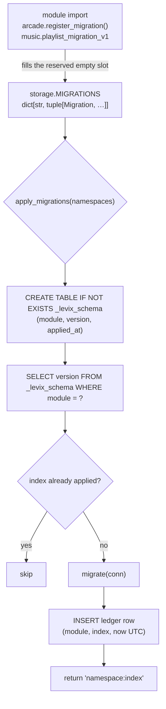

# Data storage

One SQLite file for the whole product, namespaced tables, Python migrations and a
ledger that says what has been applied. Everything here is read from
`src/levix/storage.py`, `src/levix/modules/arcade/scores.py`,
`src/levix/modules/music/core.py` and confirmed against a live database.

## Why one database

`storage.py:1-11` gives the reason, which is the dashboard:

> Why one database: the dashboard and a suspended module subprocess are two processes
> that both touch command history. Two files would double the `SQLITE_BUSY` surface and
> add another path to every caller. The tradeoff — a badly behaved plugin migration can
> lock the shared file — is mitigated by WAL, a busy timeout, and namespaced tables.

| Consideration | Decision |
|---------------|----------|
| Concurrency model | WAL journal mode, so the dashboard can read while a child writes |
| Lock tolerance | `PRAGMA busy_timeout=5000` and `sqlite3.connect(path, timeout=5.0)` |
| Thread safety | `Database.connect()` is a context manager opening a short-lived connection per call: "Never cached: Textual workers each need their own, and sqlite3 forbids sharing across threads by default" |
| Integrity | `PRAGMA foreign_keys=ON`; no table in the tree declares a foreign key today |
| Namespacing | table names carry the module (`levix_arcade_score`, `music_playlist`, `levix_command_log`) |
| Location | `Paths.data_dir / "levix.db"`, so `LEVIX_HOME`/`LEVIX_DATA_DIR` move it as a unit |
| Not used | ORM, `sqlite-utils`, aiosqlite, a second file for cache, JSONL history |

`row_factory = sqlite3.Row`, so callers index by name (`row["argv"]`).

## Migrations

| Design point | Choice | Consequence |
|--------------|--------|-------------|
| Format | Python callables taking `sqlite3.Connection`, not bundled `.sql` files | "they are type-checked, importable, and do not turn a standalone build into a data-files-bundling exercise" |
| Identity | `(module, version)` where version is the 1-based position in the tuple | a tuple may only be appended to; inserting in the middle would silently renumber |
| Namespaces reserved at import | `MIGRATIONS` ships keys `core`, `arcade`, `tube`, `ai`, `music`, `monitor`, `hacker`, `files`, the last seven empty | a module fills its own slot rather than editing core |
| Registration | `arcade/scores.register_migration()` and `music/core.ensure_schema()` append their callable if absent | idempotent, guarded by an `in` check |
| Bookkeeping | `_levix_schema(module TEXT, version INTEGER, applied_at TEXT, PRIMARY KEY (module, version))` | `levix doctor` can say what is applied; a module that ran raw DDL would be invisible |
| Default | `apply_migrations()` with no arguments iterates every namespace (`dict.fromkeys(namespaces or MIGRATIONS)`) | every caller in the tree passes an explicit tuple; no caller relies on the default |
| Return | list of `"namespace:index"` strings | `doctor._storage_finding` prints `migrations applied: core:1` or `none needed` |
| Timestamps | `_now()` = `datetime.now(UTC).isoformat(timespec="seconds")` | second resolution, always UTC, stored as text |
| Rollback | none | a bad migration is fixed forward; there is no down-migration concept |

Callers, complete:

| Caller | Namespaces | Trigger |
|--------|-----------|---------|
| `main._record` | `("core",)` | the `finally` of every command that is not a flag, best-effort |
| `doctor._storage_finding` | `("core",)` | every `levix doctor`, wrapped in `try/except` → `Status.MISSING "database unusable: …"` |
| `dashboard/history.recent_lines` | `("core",)` | every history refresh |
| `arcade/scores.ensure_schema` → `register_migration` | `("arcade",)` | `levix game scores`, `record`, and `cli.py:97` |
| `music/core.ensure_schema` | `("music",)` | every playlist operation (`core.py:633,643,665,682,688`) |

tube, ai, monitor, hacker and files have empty slots and own no tables. Files holds its
state on disk, which is the subject it manages; monitor and hacker read the OS; ai and
tube persist nothing.

## Tables, complete

`levix_command_log` — owner: core (`storage._core_v1`)

| Column | Type | Constraints | Written by | Read by |
|--------|------|-------------|-----------|---------|
| `id` | INTEGER | `PRIMARY KEY` (implicit rowid, monotonic) | `log_command` | `recent_commands`, `prune_history` ordering |
| `argv` | TEXT | `NOT NULL` | `" ".join(argv)` | dashboard history |
| `module` | TEXT | `NOT NULL` | `argv[0]` | dashboard history |
| `exit_code` | INTEGER | `NOT NULL` | the classified code | colour mapping in `dashboard/history.py` |
| `duration_ms` | REAL | `NOT NULL` | `time.perf_counter()` delta | history line |
| `ts` | TEXT | `NOT NULL` | `_now()` | history line |

Index `idx_command_log_ts (ts DESC)`. The table is a diagnostic surface, not a journal:
nothing in LEVIX reads it to decide behaviour.

`levix_arcade_score` — owner: arcade (`scores._arcade_v1`)

| Column | Type | Constraints | Meaning |
|--------|------|-------------|---------|
| `id` | INTEGER | `PRIMARY KEY` | |
| `game` | TEXT | `NOT NULL` | `snake` or `tetris`, the only values in `GAMES` |
| `score` | INTEGER | `NOT NULL` | points |
| `detail` | INTEGER | `NOT NULL DEFAULT 0` | snake final length, or tetris lines cleared — `DETAIL_LABEL = {"snake": "length", "tetris": "lines"}` |
| `seeded` | INTEGER | `NOT NULL DEFAULT 0` | 1 when the run used `--seed`, i.e. reproducible |
| `seed_value` | TEXT | nullable | the seed as text, so a huge or negative value survives exactly |
| `created_at` | TEXT | `NOT NULL` | `_now()` |

Index `idx_arcade_score_game_score (game, score DESC, id DESC)`, which is the ordering
`levix game scores` asks for.

`music_playlist` — owner: music (`core.playlist_migration_v1`)

| Column | Type | Constraints |
|--------|------|-------------|
| `id` | INTEGER | `PRIMARY KEY` |
| `path` | TEXT | `NOT NULL UNIQUE` — an autoindex enforces it, so adding the same file twice is a no-op path for the caller |
| `added_at` | TEXT | `NOT NULL` |

Index `idx_music_playlist_added (added_at)`.

`_levix_schema` — the ledger, created by `apply_migrations` itself

| Column | Type | Constraints |
|--------|------|-------------|
| `module` | TEXT | `NOT NULL` |
| `version` | INTEGER | `NOT NULL` |
| `applied_at` | TEXT | `NOT NULL` |
| | | `PRIMARY KEY (module, version)` |

Live verification against a fresh `LEVIX_HOME`: after applying core, music and arcade the
file contains tables `_levix_schema`, `levix_command_log`, `levix_arcade_score`,
`music_playlist`, indexes `idx_command_log_ts`, `idx_arcade_score_game_score`,
`idx_music_playlist_added` plus the two sqlite autoindexes, and three ledger rows
(`core/1`, `music/1`, `arcade/1`).

## History retention

| Step | Code | Rule |
|------|------|------|
| 1 | `main._record` | skipped entirely when `argv` is empty or `argv[0].startswith("-")`, and when `ctx.obj` is not a `LevixContext` |
| 2 | `obj.value("general.history_limit")` | the user's number, 0..10000, default 50 |
| 3 | `apply_migrations(("core",))` | guarantees the table exists before the first insert |
| 4 | `log_command(argv, argv[0], exit_code, duration_ms)` | one row, joined argv |
| 5 | `prune_history(limit)` | `DELETE FROM levix_command_log WHERE id NOT IN (SELECT id FROM levix_command_log ORDER BY id DESC LIMIT ?)` |
| 6 | anything raising | swallowed; `obj.logger.debug("command history not recorded", exc_info=True)` and the exit code is unchanged |

`limit=0` keeps nothing: the `LIMIT 0` subselect returns no ids, so every row is deleted.
`prune_history` returns the deleted count, which no caller uses. `levix doctor --vacuum`
is the only caller of `Database.vacuum()`.

Retention is by row count, not age, and not per module: a single limit applies to the
whole table.

## Console-safe rendering of stored values

`recent_lines` formats stored argv for a Textual `Static`, and `dashboard/history.py` maps
exit codes to colours: 0 green, `2 3 4 5 6 130` yellow, anything else red. Stored text is
re-emitted through the escaping conventions in `CORE_ENGINE.md`, so a URL containing
`[bold]` in the history does not restyle the panel.

## Known gaps

1. **`argv` is stored unredacted.** `log_command` writes `" ".join(argv)`, so a command
   that takes a secret as an argument would leave it in the shared database and in the
   dashboard's history panel. No command in the tree accepts a credential as an argument
   today: `levix ai key set` reads the key with `typer.prompt(..., hide_input=True)`
   (`modules/ai/cli.py:512-528`), so the row this command writes is `ai key set` with no
   value in it, and `config set` refuses secret-shaped keys before anything is stored. That
   makes the exposure structural rather than live — a plugin that took a key as a flag
   would land it in `levix.db` and on screen, because nothing redacts at write time, unlike
   `logging_setup.RedactFilter`, which is attached to the logger only.
2. **The `module` column stores `argv[0]`, whatever it is.** Verified on a fresh home:
   `levix config list`, `levix plugins list`, `levix doctor`, `levix game scores` and
   `levix monitor overview` all recorded rows, with `module` values `config`, `plugins`,
   `doctor`, `game`, `monitor`. Three of those are not modules. Dashboard history is
   therefore a mix of module and platform commands, and any future "per-module usage"
   reading of that column would be wrong.
3. **Global-flag invocations are not recorded at all**, because `argv[0].startswith("-")`
   short-circuits `_record`. Verified: `levix --version` and `levix -h` left no rows. Sensible
   for help, but it also means a flag-only call is invisible in the history that
   `levix doctor` and the dashboard present as "what ran".
4. **`monitor`, `hacker`, `files`, `tube`, `ai` have empty migration slots and no tables**,
   so `MIGRATIONS` currently carries five keys that can never be non-empty without a code
   change in `storage.py`. That is intentional as a namespace reservation, but it means
   `apply_migrations()` with no arguments is effectively `apply_migrations(MIGRATIONS)`
   over five no-ops, and a reader may mistake the keys for a promise of storage.
5. **`scores.py:10` and `arcade/cli.py:92` refer to `levix.database`.** The module is
   `levix.storage` and the object is `LevixContext.database`; there is no `levix.database`
   importable path. Docstrings only, no runtime effect.
6. **No schema version is enforced against `MIGRATIONS` length.** Because a version is a
   tuple index, reordering or removing an applied migration would re-run a different
   callable under an already-recorded number — silently. Nothing detects that; a checksum
   or an explicit version constant per callable is the usual guard and is absent.
7. **Arcade declares no permissions yet writes SQLite** — see
   `../security/PERMISSIONS.md`, gap 3. There is no `Permission` member for database
   writes, so the disclosure set cannot express it.
8. **No cache or state directory is used for data.** `Paths.cache_dir` and `Paths.state_dir`
   are resolved, created by `ensure()` and printed by `levix config path`, but no code
   writes into them; yt-dlp's partial files land in the chosen output directory instead.
9. **Retention is unbounded in bytes.** `history_limit` caps rows, `--vacuum` reclaims
   space by hand, and nothing bounds `duration_ms` precision or the size of a single
   `argv` column; a command with a 10 KB argument stores 10 KB per row.
10. **`_levix_schema` has no rollback concept and no checksum**, so the ledger records only
    "this callable ran", not "the database is in state X". A user who copies
    `levix.db` between machines carries the ledger with it, which is the desired behaviour
    for the migrations in this tree (all `CREATE TABLE IF NOT EXISTS`) but would silently
    mislead once a migration does something conditional.
