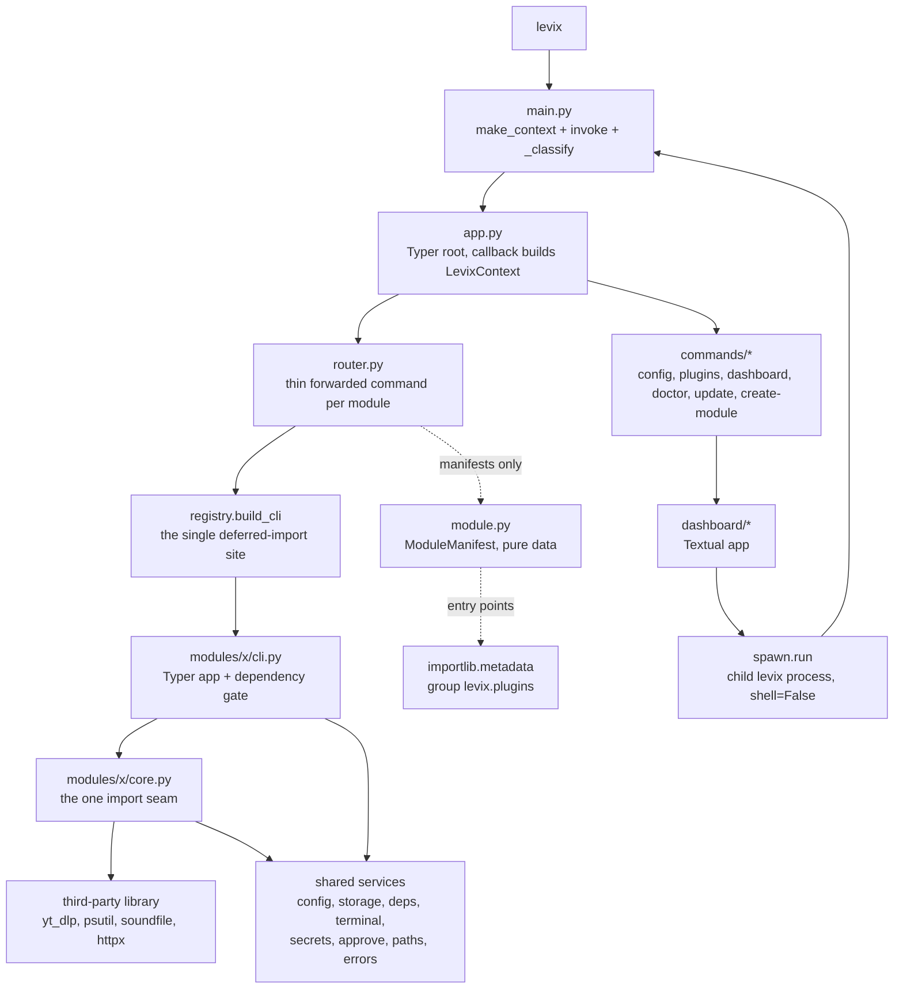

# LEVIX system architecture

Describes the system as it is built in `src/levix` at version 0.4.0 (`pyproject.toml`,
`src/levix/__init__.py`). Every path, name and code in this document was read from the
tree; where the tree and an earlier plan disagree, the tree is written here and the
difference is recorded under Known gaps.

## 1. What the system is

LEVIX is one installable console program (`levix = "levix.main:main"`) that presents a
set of independent applications — monitor, hacker, files, tube, game, music, ai —
behind a single command line, and loads third-party plugins through Python entry
points. It ships as a wheel with heavy optional dependencies behind extras, and it runs
with no network access unless a command explicitly asks for it.

The whole tree is flat:

```
src/levix/
  __init__.py  __main__.py       package identity and `python -m levix`
  app.py       main.py           Typer root and process entry point
  router.py    registry.py       module registration and discovery
  module.py    sdk.py            the registration contract and its public façade
  config.py    paths.py          layered configuration, filesystem locations
  storage.py   context.py        one SQLite file, one dependency-injection object
  errors.py    deps.py           exit-code table, dependency oracle
  terminal.py  spawn.py          glyph/colour capability, child processes
  secrets.py   approve.py        secret resolution, the confirmation gate
  capabilities.py doctor.py      probes and the health report
  logging_setup.py               rotating log with redaction
  data/defaults.toml             packaged defaults
  commands/                      platform commands (config, plugins, dashboard, doctor,
                                 update, create-module)
  dashboard/                     the Textual app (app, module_list, history, theme)
  modules/                       one package per application
                                 systempulse/ tube/ music/ arcade/ files/ hacker/ ai/
```

There is no `src/levix/cli/`, no `src/levix/core/`, no `ModuleSpec` class, no
`LevixGroup(click.Group)` subclass and no pydantic anywhere in the dependency set.

## 2. Layers

Each layer may depend on the layers above it and never on the ones below.

| # | Layer | Files | Owns | May not |
|---|-------|-------|------|---------|
| 1 | Process entry | `main.py`, `__main__.py` | click context creation, exception-to-exit-code mapping, best-effort history | print domain output, know any module name |
| 2 | Root app | `app.py` | Typer construction, the root callback, `LevixContext` creation, eager platform commands | import a module's `cli.py` or `core.py` |
| 3 | Routing | `router.py`, `registry.py` | attaching module names and aliases, forwarding argv, entry-point discovery, origin stamping | import heavy dependencies, run module logic |
| 4 | Contract | `module.py`, `sdk.py` | `ModuleManifest` and friends as pure data | import typer, rich, sqlite3 or a third-party package at module scope |
| 5 | Module surface | `modules/*/cli.py` | Typer app per module, argument parsing, rendering | touch the disk/network directly (that is layer 6) |
| 6 | Module core | `modules/*/core.py`, `scores.py`, `browse.py`, `screens.py` | the real work and the single import seam of the external library | render Rich markup, raise typer exceptions |
| 7 | Shared services | `config.py`, `paths.py`, `storage.py`, `deps.py`, `terminal.py`, `secrets.py`, `approve.py`, `spawn.py`, `capabilities.py`, `errors.py`, `logging_setup.py`, `context.py` | one authoritative answer per cross-cutting question | import from layers 3–6 |
| 8 | Platform commands | `commands/*` | `config`, `plugins`, `dashboard`, `doctor`, `update`, `create-module` | import a module package |
| 9 | Dashboard | `dashboard/*` | the Textual UI, launching children through `spawn` | reimplement availability or configuration logic |



## 3. Invariants

These hold in the current tree and are the rules future work must not break. Each is
traceable to code, and the first three are covered by tests.

| # | Invariant | Enforced by | Checked in |
|---|-----------|-----------|-----------|
| 1 | `levix --help` imports no module dependency and no Textual. Verified: after building the root command and running `--help`, `sys.modules` contains `typer._click`, `rich`, `tomlkit`, `tomllib`, `platformdirs`, `sqlite3` and none of `yt_dlp`, `psutil`, `soundfile`, `sounddevice`, `httpx`, `keyring`, `textual`. | manifests are pure data; `cli_path` is a string resolved on demand | `registry.build_cli`, `router._attach` |
| 2 | One code path for a command, whether it is typed or clicked. The dashboard never calls module internals; it re-enters `levix <module> …` in a child process. | `spawn.levix_argv` + `App.suspend()` | `dashboard/app.py:164-174`, `tests/test_dashboard.py` |
| 3 | Core dependencies stay lightweight. `pyproject.toml` pins only click, platformdirs, rich, textual, tomlkit and typer; psutil, yt-dlp, soundfile/sounddevice, httpx and keyring are extras, with the comment "Core stays lightweight. Nothing below is a module-specific dependency." | extras + the `deps.ensure_dependencies` gate | `pyproject.toml`, `deps.py:121` |
| 4 | Every external-library import in a module sits behind exactly one seam function. | convention, documented in each `core.py` | `_make_ydl`, `play_samples`, `build_client`, `import psutil` per function |
| 5 | Subprocesses are argument lists with `shell=False`, everywhere, without exception. | code review; ruff `S` rules with only `S603`/`S607` ignored | `spawn.py:31`, `tube/core.py:182`, `hacker/core.py:296`, `ai/core.py:429-431`, `secrets.py:144`, `commands/config_cmd.py:182` |
| 6 | A capability that does not exist is reported as `UNSUPPORTED`, never as a fabricated value. | `capabilities.py` probes | gpu and temperature probes |
| 7 | Secrets are never printed or logged. | `RedactFilter`, `levix config` masking, `context.secret` logs only the source | `logging_setup.py`, `config_cmd.py:_MASK` |
| 8 | One `LevixContext` per process, passed through `ctx.obj`; no module-level mutable state except the registry accessor. | `context.py` docstring, `registry.active()` comment | `app.py:83`, `router.py:99-104` |
| 9 | Migrations are Python callables in a namespaced dict; no module runs unrecorded DDL against the shared file. | `storage.MIGRATIONS` + `_levix_schema` | `music/core.py:611` and `music/core.py:624`, `arcade/scores.py:69` |
| 10 | Failure is a code before it is prose: every user-visible failure ends in the table in `errors.py`. | `main._classify` | see `ERROR_HANDLING.md` |

## 4. Boundaries

| Boundary | What crosses it | Shape |
|----------|-----------------|-------|
| OS → LEVIX | argv | `main(argv: list[str] \| None)` |
| LEVIX → module | module's own argv, plus `obj` | `command.main(args=…, prog_name=f"levix {name}", standalone_mode=False, obj=ctx.obj)` |
| Module → shared services | a dotted config key, a `Path`, a `ModuleManifest` | plain data only; no module imports another module |
| LEVIX → child LEVIX | argv again, never a pickle | `[sys.executable, "-m", "levix", *args]`, or `[sys.executable, *args]` when `sys.frozen` |
| LEVIX → third-party tool | argument list | `shutil.which` first, then `subprocess.run(argv, shell=False, check=False)` |
| LEVIX → disk | five platform directories | `Paths`, overridable by `LEVIX_HOME` and `LEVIX_{CONFIG,DATA,CACHE,STATE,LOG}_DIR` |
| LEVIX → network | only three places | `update_cmd.py` (pypi.org JSON), `ai/core.py` (configured provider), `tube/core.py` (yt-dlp) |

## 5. Process and thread model

Single process per command, one-shot, no daemon, no background jobs.

| Situation | Handling |
|-----------|----------|
| Dashboard + module | Textual `App.suspend()` releases the TTY, `spawn.run` blocks, the app resumes and calls `refresh_history()` |
| Textual workers | `Database.connect()` opens a short-lived connection per call because sqlite3 forbids sharing a connection across threads |
| Streaming | yt-dlp progress hooks and `rich.live.Live` run on the main thread; no thread is created by LEVIX code |
| Interrupts | `KeyboardInterrupt` → `main.py` writes `\ninterrupted\n` and returns 130; click's `Abort` maps to the same code |

## 6. Build and packaging

| Concern | Decision | Where |
|---------|----------|-------|
| Backend | `hatchling.build` (>=1.33,<2) | `pyproject.toml` |
| Python | `requires-python = ">=3.12"`; ruff `target-version = "py312"`; mypy `python_version = "3.12"` | `pyproject.toml` |
| Data files | `data/defaults.toml` force-included into the wheel | `[tool.hatch.build.targets.wheel.force-include]` |
| Plugins in sdist | `plugin-examples` included | `[tool.hatch.build.targets.sdist]` |
| Entry points | seven `levix.plugins` declarations pointing at `levix.modules.<x>:MANIFEST` | `[project.entry-points."levix.plugins"]` |
| Lint | ruff selects `E F W I UP B C4 SIM RUF T20 S`, ignores only `S603` and `S607`; per-file ignores for B008 in Typer surfaces and S608 where the table name is a constant | `[tool.ruff]` |
| Types | mypy `strict = false`, `disallow_untyped_defs = true`, `warn_unused_ignores = true` | `[tool.mypy]` |
| Tests | pytest with `--strict-markers`, markers `integration` and `slow`, branch coverage on | `[tool.pytest.ini_options]` |

## 7. Related documents

| Question | Document |
|----------|----------|
| What does each core file own? | `CORE_ENGINE.md` |
| How does `levix tube info URL` reach a function? | `COMMAND_ARCHITECTURE.md` |
| What must a module implement? | `MODULE_ARCHITECTURE.md` |
| How do out-of-tree plugins register? | `PLUGIN_ARCHITECTURE.md` |
| Where does a config value come from? | `CONFIGURATION_ARCHITECTURE.md` |
| Which tables exist and who owns them? | `DATA_STORAGE.md` |
| What does each exit code mean? | `ERROR_HANDLING.md` |
| What is protected and how? | `../security/THREAT_MODEL.md`, `../security/PERMISSIONS.md` |

## 8. Known gaps

* `registry.build_screen` and `UiSpec(mode="screen", screen_path=…)` exist and are
  tested only for their failure path (`tests/test_registry.py:166-169`), but no manifest in
  the tree declares `screen` — all seven use `suspend`. In-app screen embedding is
  therefore designed but unused; `docs/architecture` should not promise it.
* `CHANGELOG.md` described "lazy `LevixGroup` command routing". No `LevixGroup` class
  exists; laziness comes from forwarding (`router.py`, `ADR-0003`). The changelog line is
  corrected, and this is the kind of drift `docs/roadmap/CURRENT_STATUS.md` exists to catch.
* Manifests point at `documentation="docs/modules/AI.md"`, `ARCADE.md`, `FILES.md`,
  `HACKER.md`, `MUSIC.md`, `SYSTEMPULSE.md` and `TUBE.md`. All seven exist, so
  `levix plugins info` prints a path that resolves. The doc set itself is indexed by
  `docs/INDEX.md`; the state handoff is `docs/roadmap/CURRENT_STATUS.md`.
* `docs/requirements`, `docs/decisions`, `docs/security` and `docs/technology` exist and
  are the consolidated form of the earlier plan's separate `docs/plugins/` and
  `docs/development/` trees: SDK material lives in this directory's
  `PLUGIN_ARCHITECTURE.md`, coding standards in `../../CONTRIBUTING.md`, security in
  `../security/THREAT_MODEL.md` and `../security/PERMISSIONS.md`.
* The hand runs behind this document set were performed on Windows (`sys.platform =
  "win32"`). GitHub Actions has since executed the non-integration suite on Ubuntu and macOS
  as well: run #3 made **all six columns red on eight test functions that depend on the
  machine they run on** - escape codes in help output, because typer forces a terminal
  whenever `GITHUB_ACTIONS` is set (every platform); a deletion that judged a symlink by its
  target rather than by its own place (Ubuntu, macOS); the `\\?\` device form `os.readlink`
  returns for a Windows link; two tests that asked a headless runner which sound cards it
  has; a 68-character macOS hostname that did not fit a table column; and a notice that
  wrapped at 80 columns. Run #4 (`5b047ad`) came back **green on all seven jobs**, which is
  what confirmed each of those eight on the platform that found it. What that still does not
  buy: the columns skip the ten `integration` cases, no command has been run by hand on Linux
  or macOS, and several POSIX behaviours have no assertion behind them at all -
  `docs/roadmap/CURRENT_STATUS.md` keeps the list.
