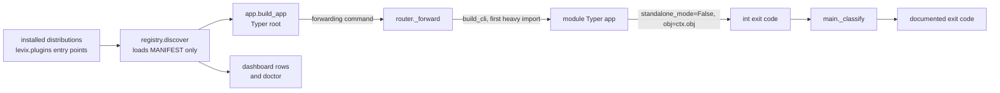

# LEVIX Product Requirements Document

| Field | Value |
| --- | --- |
| Product | LEVIX, an installable Python CLI ecosystem |
| Version described | 0.4.0 (`pyproject.toml`, `project.version`) |
| Status | Initial official modules shipped; not yet published to PyPI |
| Written | 2026-11-04 |
| Source of truth | The source tree. Every statement below is traceable to a file or a command. |
| Related docs | `docs/requirements/FUNCTIONAL_REQUIREMENTS.md`, `NON_FUNCTIONAL_REQUIREMENTS.md`, `USER_STORIES.md`, `ACCEPTANCE_CRITERIA.md`, `docs/decisions/ADR-0001` to `ADR-0006` |

## 1. Mission

**One CLI. Multiple applications. Unlimited extensibility.**

That sentence is not marketing prose: it is the literal `description` field in
`pyproject.toml`, the `APP_HELP` constant in `src/levix/app.py`, and the first line
`levix --help` prints.

The problem LEVIX solves is the pile of small, single-purpose terminal tools a developer
ends up installing and re-learning — a monitor, a downloader, a player, a file manager,
a score board. Each brings its own config location, its own logging, its own opinion
about credentials and its own idea of what "not supported on this platform" means. LEVIX
puts all of them behind one executable, with one configuration system, one database, one
secret store, one redacting logger, one confirmation gate and one exit-code table, and
then makes the set open: any Python distribution that registers a `levix.plugins` entry
point becomes a first-class `levix <name>` command.

## 2. Product definition

| Aspect | As built | Evidence |
| --- | --- | --- |
| Distribution | `levix`, version `0.4.0`, MIT, `src/levix` layout built by hatchling | `pyproject.toml` |
| Python | `>=3.12` (classifiers also list 3.13); `.venv` in this repo runs 3.12.10 | `pyproject.toml`, installed metadata |
| Console entry | `levix = "levix.main:main"` | `pyproject.toml`, `[project.scripts]` |
| Module entry | `python -m levix` supported | `src/levix/__main__.py` |
| Core dependencies | `click>=8.5,<9`, `platformdirs>=4.14,<5`, `rich>=15.0,<16`, `textual>=8.2,<9`, `tomlkit>=0.15,<1`, `typer>=0.27,<0.28` | `pyproject.toml` |
| Heavy dependencies | Optional extras only: `monitor`, `tube`, `music`, `ai`, `secrets`, `all`, `dev` | `pyproject.toml`, see `ADR-0006` |
| Plugin contract | entry-point group `levix.plugins` pointing at a `ModuleManifest` object | `pyproject.toml`, `src/levix/registry.py`, `src/levix/module.py` |
| Configuration | TOML, layered defaults → user file → environment → flags | `src/levix/config.py`, `src/levix/data/defaults.toml`, see `ADR-0004` |
| Storage | one SQLite file, WAL, per-module migration namespaces | `src/levix/storage.py` |
| Secrets | environment → OS keyring → owner-only file | `src/levix/secrets.py`, see `ADR-0005` |

## 3. Who it is for

- **A developer on their own machine** who wants monitoring, downloads, local audio,
  file work and small games without six tools and six config files.
- **A script or CI author** who shells out to `levix` and needs stable exit codes and
  output that survives redirection (`docs/requirements/NON_FUNCTIONAL_REQUIREMENTS.md`).
- **A third-party author** who wants to distribute a module for that installed base using
  only standard packaging metadata (`levix create-module`, `src/levix/commands/create_module_cmd.py`).

## 4. What ships in 0.4.0

### 4.1 The seven official modules

All seven are entry points of the `levix` distribution itself, so each is discovered
exactly like a plugin (see `ADR-0002`). Names, summaries, commands, extras, permissions
and dashboard behaviour are read from the manifests in
`src/levix/modules/*/__init__.py`.

| Module | Title | Summary (help text) | Commands | Extra | Declared permissions | Dashboard argv |
| --- | --- | --- | --- | --- | --- | --- |
| `monitor` | SystemPulse | CPU, memory, disk, network and process monitoring. | overview, cpu, memory, disk, network, processes, live | `monitor` (`psutil>=7.2,<8`) | `fs_read` | `monitor live` |
| `hacker` | Hacker | Matrix rain plus a read-only tour of this machine's own network setup. | matrix, info, network | none | `fs_read`, `subprocess` | `hacker matrix` |
| `files` | Files | Terminal file manager: browse, search, preview, copy, move, rename, delete. | browse, search, preview, copy, move, rename, delete | none | `fs_read`, `fs_write` | `files browse` |
| `tube` | Tube | Inspect, download or play online video through yt-dlp, with honest gates. | info, download, play | `tube` (`yt-dlp>=2026.10.26`) | `audio`, `fs_write`, `network`, `subprocess` | none → opens `tube -h` |
| `game` | Arcade | Snake and Tetris in a Textual screen, with high scores stored in SQLite. | snake, tetris, scores | none | none | `game snake` |
| `music` | Music | Play, inspect and queue local audio - WAV, FLAC, OGG, MP3 without ffmpeg. | play, info, devices, library, playlist | `music` (`sounddevice>=0.5,<1`, `soundfile>=0.14,<1`) | `audio`, `fs_read` | `music library` |
| `ai` | AI Assistant | Ask, explain and propose commands against your own model server. | ask (`q`), explain, command (`cmd`), models, check, key (`set`/`clear`) | `ai` (`httpx>=0.28,<1`) | `network`, `secret_read`, `secret_write`, `fs_read`, `subprocess` | `ai check` |

`levix tube` deliberately declares no dashboard argv: every Tube command needs a URL the
dashboard cannot supply, so the row opens help instead (`tests/modules/test_tube.py::test_the_manifest_declares_the_packaged_contract`
asserts `MANIFEST.ui.argv == ()`).

### 4.2 Platform commands

| Command | Purpose | Implementation |
| --- | --- | --- |
| `levix` (bare) | open the dashboard | `src/levix/app.py` root callback → `commands/dashboard_cmd.py` |
| `levix dashboard` | interactive Textual module list, filter, launch, history, themes | `src/levix/dashboard/app.py` |
| `levix doctor` | dependencies, capabilities, paths, config, storage, secrets; `--json`, `--only`, `--vacuum` | `src/levix/doctor.py`, `commands/doctor_cmd.py` |
| `levix config` | show, list, get, set, unset, reset, path, edit | `commands/config_cmd.py`, `config.py` |
| `levix plugins` | list, info | `commands/plugins_cmd.py` |
| `levix update` | check PyPI for a newer version; never self-install | `commands/update_cmd.py` |
| `levix create-module` | scaffold a plugin project using the same contract | `commands/create_module_cmd.py` |
| `levix --version` / `-V` | print `levix <version>` and exit 0, eagerly, before any context is built | `src/levix/app.py` |

### 4.3 What a plugin is

A plugin is **any installed Python distribution that publishes an entry point in the
`levix.plugins` group whose value is a `ModuleManifest` object**, plus a lazily importable
factory at `cli_path`.

```
pyproject.toml                     module package
[project.entry-points."levix.plugins"]      levix_weather:MANIFEST
  weather = "levix_weather:MANIFEST"   ->   MANIFEST = ModuleManifest(...,
                                                    cli_path="levix_weather.cli:build_app")
```

Consequences of that definition, all as built:

- Discovery is metadata only. `registry.discover()` calls `entry_point.load()` on a
  data object; `build_cli()` is "the single deferred-import site for module CLIs"
  (`src/levix/registry.py`).
- The manifest cannot claim to be official. `origin` is stamped by the registry from the
  provider distribution (`_origin_for`), and `tests/test_registry.py::test_a_plugin_cannot_claim_to_be_official`
  pins that.
- The author's declared `permissions` are disclosure, not enforcement: `levix plugins info`
  prints "declared permissions are a promise by the author, not an enforced limit.
  Python plugins can do anything LEVIX can." (`commands/plugins_cmd.py`).
- A plugin that fails to import is listed as broken and explained, not fatal
  (`registry._broken`).
- The public surface for plugin authors is `levix.sdk`, a façade with no logic that
  re-exports 14 names (`src/levix/sdk.py`).
- A plugin is installed with ordinary `pip install -e .` and is then visible to
  `levix plugins list`; LEVIX itself performs no installation in 0.4.0.



## 5. Product invariants

These four properties are the reason the architecture looks the way it does. Each is
tested today.

1. **Help is cheap.** `levix --help` and `<module> -h` import none of
   `psutil`, `yt_dlp`, `sounddevice`, `soundfile`, `numpy`, `textual`
   (`tests/test_router.py::test_help_forwarding_does_not_import_a_heavy_dependency`,
   `test_an_official_module_help_does_not_import_its_own_dependency`).
2. **Failure is data.** A broken plugin, an unavailable sensor, a missing extra and an
   unknown theme are all reported with the same seriousness as a success; LEVIX never
   fabricates a value ("not reported", "unsupported" rows in `monitor`, `capabilities.py`,
   `theme.py`).
3. **One vocabulary for failure.** Every error path funnels into the single exit-code
   table in `src/levix/errors.py` (0, 1, 2, 3, 4, 5, 6, 7, 8, 130).
4. **A human must agree to destruction.** Deletes, overwrites, score clears and AI-proposed
   commands all go through `levix.approve.require_approval(..., destructive=True)`, where
   `--yes` is explicitly refused and a non-interactive stdin counts as a refusal.

## 6. Success criteria

| # | Criterion | How it is measured | State at writing |
| --- | --- | --- | --- |
| S1 | One executable covers seven applications | `levix --help` lists dashboard, doctor, update, create-module, config, plugins and all seven modules | met |
| S2 | Installing the core pulls no heavy dependency | core dependency list is 6 packages; `pyproject.toml` extras hold the rest | met |
| S3 | Startup help stays free of module imports | child-interpreter `sys.modules` assertions in `tests/test_router.py`, `tests/modules/*` | met |
| S4 | Full automated suite passes | `python -m pytest -o addopts="" -q` → `700 passed, 5 skipped in 124.42s`, exit 0 | met on Windows only |
| S5 | Exit codes are documented and stable | `errors.py` table plus the exit-code-named tests in `tests/modules/` | met |
| S6 | Third party can ship a module with metadata only | `levix create-module` scaffold, `commands/create_module_cmd.py` | scaffold generated and covered by tests; end-to-end install of a generated package is not covered by a test in this repo |
| S7 | No credential ever reaches a log or config file | `logging_setup.RedactFilter`, `config.is_secret_key` masking, `secrets.py` chain | met in code; only Windows keyring path exercised |
| S8 | Destructive actions cannot be automated away | `approve.require_approval` + the `--yes cannot authorize` tests | met |
| S9 | Linux and macOS behaviour verified | not run in this environment | **not met** (see Known gaps) |

## 7. Explicitly not in this release

| Not shipping in 0.4.0 | What exists instead | Evidence |
| --- | --- | --- |
| `levix plugins install` / `uninstall` / `publish` | read-only `list` and `info`; installation is `pip install -e .` | `commands/plugins_cmd.py` docstring: "Installation and removal are deliberately NOT implemented here… the consent flow plus the pipx/frozen-environment questions need to be settled" |
| A consent/security model for third-party code | disclosure only: `permissions` in manifests, warned about in `plugins info` | `commands/plugins_cmd.py` |
| Self-updating | `levix update` prints the PyPI version and the commands to run; never installs | `commands/update_cmd.py` ("LEVIX does not modify its own installation") |
| CI / CD pipelines | `.github/workflows/ci.yml` (3 OSes x Python 3.12/3.13 + a no-extras wheel job) and `release.yml` (tag → build → GitHub Release → PyPI) exist. `ci.yml` **ran three times on 2026-11-05**: the wheel job passed on Ubuntu every time, and the third run - the first whose suite result could be trusted, the second one having gone green by masking its own failures through a `tee` - was red on all six columns on eight machine-dependent tests. All eight are fixed in the tree; a fourth run has to agree before any column may be quoted. `release.yml` has still never run | `.github/workflows/ci.yml`, `ACCEPTANCE_CRITERIA.md` §Criteria that cannot be accepted on this machine yet |
| PyPI upload | `levix update` reads `https://pypi.org/pypi/levix/json`, which presumes a public `levix` name; the name is unclaimed (404) and `release.yml` would publish it once the project and its trusted publisher exist | `commands/update_cmd.py`, `docs/technology/PYTHON_PACKAGING.md` §Publishing |
| Standalone binaries | `spawn.is_frozen()` support exists so a frozen build would re-exec itself, but no build is produced | `src/levix/spawn.py`, `CHANGELOG.md` "no standalone binaries yet" |
| In-dashboard full-screen modules | every module uses `UiSpec(mode="suspend")`; `registry.build_screen` and `UiSpec.screen_path` are not used by the dashboard | `src/levix/module.py`, `dashboard/app.py` |
| Enforced plugin sandboxing | none; documented as impossible for in-process Python plugins | `plugins_cmd.py` |

## 8. Known gaps in the tree

- `CHANGELOG.md` used to describe "lazy `LevixGroup` command routing". No `LevixGroup`,
  `src/levix/cli/` or `src/levix/core/` exists; routing is the forwarding design in
  `src/levix/router.py` (`ADR-0003`). The 0.4.0 entry now says "lazy forwarding router".
- `CONTRIBUTING.md` pointed at `tests/test_lazy_loading.py`, which does not exist;
  the invariant lives in `tests/test_router.py` and the per-module tests. Corrected.
- The documentation set is `docs/INDEX.md` (navigation), `docs/requirements`,
  `docs/architecture`, `docs/modules`, `docs/security`, `docs/technology`,
  `docs/decisions` and `docs/roadmap/CURRENT_STATUS.md`. The earlier plan's separate
  `docs/plugins/`, `docs/development/` and `docs/security/SECURITY_OVERVIEW.md` were
  consolidated instead of duplicated: SDK and install material in
  `docs/architecture/PLUGIN_ARCHITECTURE.md`, standards in `CONTRIBUTING.md`, security
  in `docs/security/THREAT_MODEL.md` + `docs/security/PERMISSIONS.md`. Every link in
  `README.md` and in the shipped hint strings now resolves to one of those files.
- `levix doctor --only modules` and `--only capabilities` used to print the whole report:
  `prefix` was computed and never applied in `commands/doctor_cmd.py`. The filter is applied
  now, and `tests/test_doctor.py` pins each area's row prefixes plus the `--json` verdict.
- `general.theme` and the dashboard now speak the same vocabulary. `config.SCHEMA` offers
  `default|hacker|minimal|high-contrast`; `dashboard/theme.py` registers four themes and
  aliases every one of those names onto a real one, so `hacker` applies the green palette
  instead of reporting "unknown theme". `tests/test_dashboard.py` fails if the two lists
  drift apart again.
- `general.confirm_destructive` and `dashboard.show_system_info` were in `SCHEMA` and in the
  packaged defaults and were read by nothing. Both are removed: `approve.require_approval`
  gates every destructive action unconditionally (the same reason `--yes` is ignored there),
  and the dashboard has no system-info panel to hide. `ai.require_approval` stays because
  `ai/cli.command` genuinely reads it, prints a loud warning when it is false, and still
  refuses to run anything without `--run`.
- `UnknownModuleError` (exit 4) is defined and exported through `levix.sdk` but never
  raised; code 4 comes from `main._classify` matching click's "No such command" text.
- `ModuleRegistry(extra_entry_points=...)` is accepted and merged into discovery, but no
  caller or test uses it; tests subclass `_entry_points` instead.
- Two hint strings pointed at commands that did not exist. `config set`'s refusal named
  `levix ai key set` and `modules/ai/core.py:42` referred to a `levix secrets` command: the
  first now exists (`ai/cli.py:519-594`, `key set` and `key clear`, nine tests), the second
  comment has been rewritten to name the env var and the real command.
- `src/levix/dashboard/app.py::refresh_modules` claimed `levix plugins install` in another
  shell would become visible. That command is still deliberately unimplemented (§7), so the
  comment now says what the function does: re-read the registry, so a plugin installed into
  this environment appears.
- `src/levix/router.py`'s comment uses `levix monitor cpu --json` as an example, but no
  module command offers `--json`: only `doctor` and `update` do.
- Verification is Windows-only (`CHANGELOG.md` says the same). Nothing here was run on
  Linux or macOS.
- Lint and typing are clean: `ruff check src tests`, `ruff format --check src tests` and
  `mypy src/levix` all exit 0 on this machine (the earlier 44-findings / 65-errors state is
  gone). See `NON_FUNCTIONAL_REQUIREMENTS.md` NFR-9.1/NFR-9.5 for the evidence.
